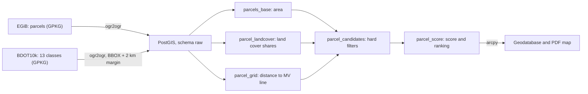
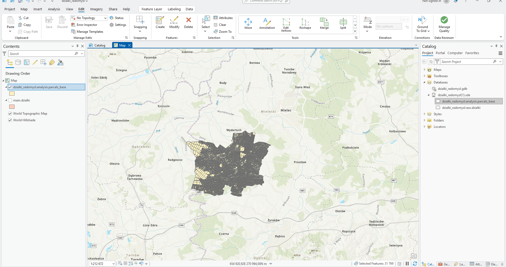
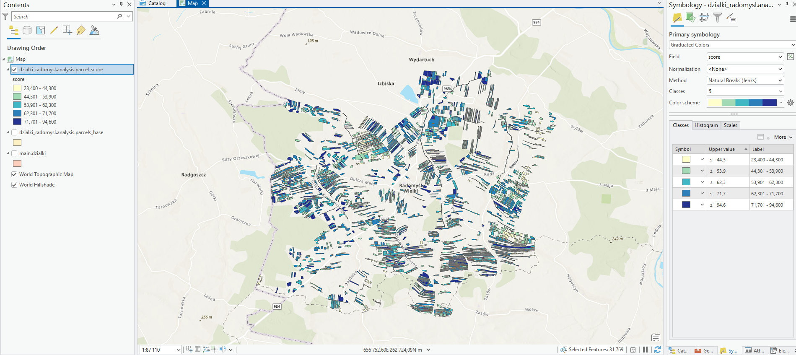
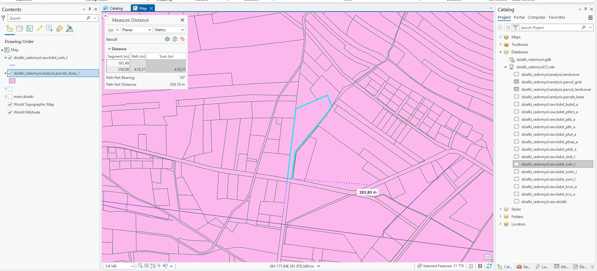

# Parcel Scoring for Solar Farm Siting: Radomyśl Wielki Municipality

A spatial analysis pipeline that scores cadastral parcels in the municipality of Radomyśl Wielki (southern Poland) for ground-mounted photovoltaic (solar farm) siting. Stack: PostgreSQL/PostGIS, SQL, GDAL, Python, ArcGIS Pro (arcpy).


## Overview

I built this project to practise the full spatial data workflow, from raw data download to a final map. Using public data from the Polish Head Office of Geodesy and Cartography (GUGiK: cadastre and BDOT10k topographic database), I build a PostGIS database, calculate land cover shares and the distance to power lines for 31,769 parcels, filter out unsuitable parcels, and score the remaining ones from 0 to 100. The 50 best parcels are exported to ArcGIS Pro with an arcpy script, and a map is produced.

This is a **preliminary, assumption-based site screening**, not an investment assessment. Weights and thresholds are described in "Methodology" and "Limitations".

## Data

| Data | Source | Format | Notes |
|---|---|---|---|
| Cadastral parcels (EGiB) | Geoportal, "Download data" module, Mielec county | GPKG | state as of 7 Oct 2026; 191,663 parcels in the county, 31,769 in the municipality |
| BDOT10k | Geoportal, Mielec county | GPKG (one file per object class) | downloaded 14 Oct 2026; 13 of 63 classes imported |
| Municipality area (check) | [link to the municipal report] | PDF | compared with the sum of parcel areas |

The data is not stored in the repository (file size). Download it from Geoportal and place it in `data/raw/` (see "How to run").

Imported BDOT10k classes: forests (`PTLZ`), grassland and arable land (`PTTR`), permanent crops (`PTUT`), surface water (`PTWP`), built-up areas (`PTZB`), transport areas (`PTKM`), power lines (`SULN`), roads (`SKDR`), buildings (`BUBD`), rivers and canals (`SWRS`, `SWKN`), protected areas (`TCON`, `TCRZ`). Roads, buildings and the water network are in the database but are not yet part of the scoring.

## Data flow



The `dzialki_radomysl` database has two schemas: `raw` (source data, unchanged) and `analysis` (calculation results, reproducible with the scripts). All data uses the EPSG:2180 coordinate system.

 
 
## Methodology

### 1. Land cover classification

| Class | Role | Rationale |
|---|---|---|
| forest, grove | exclusion | tree cover, legal restrictions |
| water, built-up, transport areas, protected areas | exclusion | |
| tree belts, orchards, plantations, nurseries | penalty | shading, valuable crops |
| grassland | preferred land | |
| arable land | candidate land | grassland is ranked higher |

### 2. Hard filters (candidates)

A parcel must be at least 1 ha, have at most 20% of its area covered by excluded land cover, and at least 70% grassland or arable land. In the municipality this leaves **1,866 parcels (3,278 ha)**.

### 3. Scoring (0 to 100)

| Component | Formula | Weight |
|---|---|---|
| Proximity to a medium-voltage line | `1 − min(distance / 1000 m, 1)` | 0.35 |
| Area | `min(ha / 5, 1)` | 0.25 |
| Land type | `grass share + 0.5 × arable share` | 0.20 |
| "Cleanliness" | `max(1 − excluded share − penalty share, 0)` | 0.20 |

The result is multiplied by **0.7** if a power line crosses the parcel (a restriction on construction). **The weights, thresholds (1 ha, 20%, 70%, 1000 m, 5 ha) and the 0.7 factor are working assumptions, not the result of calibration.** They are defined in one place (`WITH params` in `sql/11_parcel_candidates` and `13_parcel_score`), so they are easy to change.

## Results



- **31,769 parcels**, about 15,966 ha in total, which matches the area of the municipality (about 160 km²).
- **Strong fragmentation:** 72% of parcels are smaller than 0.5 ha, yet they cover only about 25% of the area. Parcels of 1 ha or more are 12% of the count and about 52% of the area.
- **Land cover:** 59% of the area is grassland or arable land, 40% is excluded land.
- **Grid:** the study area contains 412 operating power lines (405 medium-, 5 high- and 2 extra-high-voltage). Among the candidates, 495 parcels (26.5%) have a medium-voltage line crossing or touching the parcel, and only 37 are farther than 1 km from such a line.
- **Candidate scores:** from 23.4 to 94.6, mean 58.6. Parcels without a line average 61.8, those with a line 51.2.
- **Top ten:** parcels of 2.6 to 7.7 ha, 8 to 246 m from a medium-voltage line, none with a line crossing the parcel. They lie in cadastral districts such as Dulcza Mała, Zgórsko, Podborze and Żarówka.


### Validation

- Row counts in every table match the previous stage (`sql/03`, `08`, `10`, `12`, `14`).
- A distance measured manually in ArcGIS Pro matches the value calculated in the database 
- The score distribution and the line-crossing penalty were checked with validation queries.



## How to run

**Requirements:** PostgreSQL with PostGIS (tested: PostgreSQL 18, PostGIS 3.6), GDAL (e.g. from OSGeo4W/QGIS), Python 3 with `python-dotenv`, ArcGIS Pro with a licence (last step only).

1. **Data:** from Geoportal ("Download data" module) download the parcels of Mielec county (GPKG) as `data/raw/1811.gpkg` and BDOT10k of Mielec county (GPKG) into `data/raw/1811_GPKG/`.
2. **Configuration:** copy `.env.example` to `.env` and enter the database password; in `config/settings.py` check the host, port (5433 in my setup) and database name.
3. **Database:** run `sql/01_create_database.sql` (in the `postgres` database), then `sql/02_create_schemas.sql` (in `dzialki_radomysl`).
4. **Import parcels:** run `scripts/01_import_parcels_ogr2ogr.bat` in OSGeo4W Shell (set `PGPASSWORD` first).
5. **Import BDOT10k:** calculate the bounding box with a margin (`SELECT ST_Extent(ST_Expand(geom, 2000)) FROM raw.dzialki;`), put it into `BBOX` in `scripts/02_import_bdot10k.bat` and run it.
6. **Analysis:** run `sql/04`, `07`, `09`, `11`, `13` in order (each followed by its validation file).
7. **Export to ArcGIS:** in the ArcGIS Pro Python Command Prompt run `arcgis/01_export_top_parcels.py` (set the paths to the `.sde` file, the `.aprx` project and the geodatabase; the `.sde` file contains login data and is not in the repository).

Tables meant for ArcGIS have an `objectid` column, because geoprocessing tools require an integer identifier.

## Repository structure

```
config/    settings (host, port, municipality TERYT code)
data/      source data (not in the repository)
sql/       SQL scripts in execution order, separate validation files
scripts/   data import (ogr2ogr)
arcgis/    arcpy script: export of the best parcels and PDF map
docs/      screenshots and maps
```

## Limitations

- The parcel data has no land use attributes (land use class, soil quality class); land cover comes from BDOT10k, which is less detailed than the cadastre.
- "Line crosses parcel" also includes lines running along the parcel boundary and applies to all voltage levels. The length of the line inside the parcel is not measured.
- The score ignores parcel shape (many candidates are narrow strips), distance to roads, terrain slope, solar exposure, ownership and local zoning plans.
- No Natura 2000 areas occur in the study area; the only object in the nature reserve class is Bagno Przecławskie.
- Weights and thresholds are assumptions, without calibration.
- The arcpy script requires an ArcGIS Pro licence and local paths.

## What I learned and next steps

PostGIS (`ST_Intersection`, `ST_Distance`, `LATERAL` with the `<->` operator, GIST indexes), idempotent SQL scripts and separate result validation, GDAL/ogr2ogr, `arcpy.mp` (project, map, layout), Git, and working with data too large for the repository.

Ideas for further work: a parcel compactness measure (`ST_MaximumInscribedCircle`), merging adjacent parcels into larger areas, distance to roads and buildings, slope from a digital terrain model, sensitivity analysis of the weights.

## License

MIT